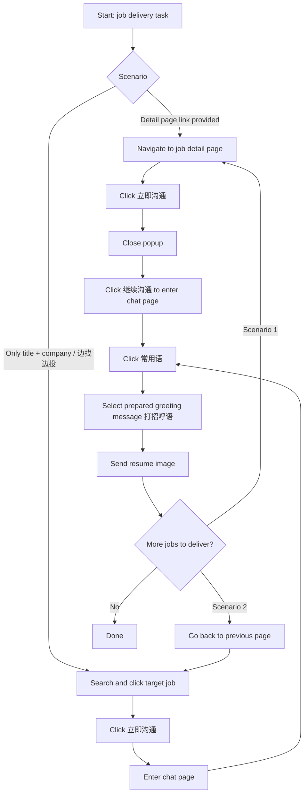

# Boss直聘 Delivery Workflow

Deliver job applications on Boss直聘 using browser automation. There are two delivery scenarios, and both share the same chat-page delivery steps after entering the conversation.

## Step 0: Prepare the greeting message (前提)

Before any delivery, ensure a qualifying greeting message (打招呼语) exists:

1. Navigate to the greeting settings page: 消息通知 → 设置打招呼语.
2. Make sure the **启用招呼语** button is OFF (关闭). If it is on, click it to turn it off.
3. Open the **常用语（x条）** page and take a screenshot to check the existing greetings.
4. If no greeting satisfies the requirements below, edit or create one so that it does.

### Greeting message requirements (招呼语要点)

- Under 200 Chinese characters. Structure, in order: 能力展示 + 个人信息 + 求职意向 + 到岗信息.
- **能力展示**: lead with the ability most relevant to the target job's JD, then rank the rest. Example (product manager role): "5年产品经理经验/从0-1完成产品全流程跟进".
- **个人信息**: school – graduation year – major and degree. Example: "我是北京大学27届毕业的计算机本科生".
- **求职意向**: e.g. "我对这个岗位很感兴趣，希望能跟您深入交流".
- **到岗信息**: current location, earliest available date (最快x月x日到岗), attendance days per week (每周能出勤x天). **Ask the user for these details** if not already provided.

## Step 1: Deliver to a job

Pick the scenario based on what the user provides, then follow the shared chat-page flow.

### Scenario 1: Job detail page link is available

1. Navigate to the job detail page.
2. Click **立即沟通**.
3. Close the popup that appears.
4. Click **继续沟通** to enter the chat page.
5. Continue with the shared delivery flow below.
6. When finished, navigate to the next job detail page and repeat.

### Scenario 2: Only job title and company name are given, or the user asks to 边找边投

1. Search for the target job and click it from the results.
2. Click **立即沟通** to enter the chat page.
3. Continue with the shared delivery flow below.
4. When finished, go back to the previous page and repeat with the next job.

### Shared delivery flow (chat page)

1. Click **常用语**.
2. Select the prepared greeting message (打招呼语).
3. Send the resume image.
4. Move on to the next job per the scenario's repeat rule.

## Delivery flow diagram

